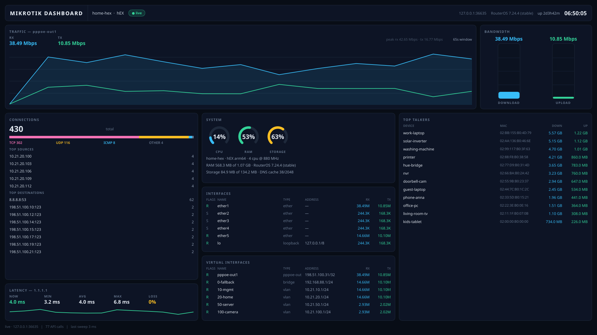

# Mikrotik Dashboard

A native dashboard for MikroTik RouterOS, drawn with [Slint](https://slint.dev) on a
fixed **1920x1080** surface. It speaks the RouterOS **binary API** straight from
Rust — nothing scrapes the web UI, logs in over SSH, or uses REST — so it is one
binary and one window, with no browser, service or database behind it.



## Run it

```bash
cargo run --release --bin mikrotik-dashboard -- --demo
cargo run --release --bin mikrotik-dashboard -- --target 192.0.2.1:8728 --user mikdash --password-env MIKDASH_PASSWORD
cargo run --release --bin mikrotik-dashboard -- --probe --demo --seconds 6
cargo run --release --bin mikrotik-dashboard -- --screenshot frame.ppm --demo --seconds 20
```

- `--demo` starts a RouterOS-shaped API server on a local port and points the client
  at it, so framing, login and the poll loop are exercised end to end with no router
  present.
- `--probe` polls headless and prints one frame as text — the same numbers the window
  draws, for a machine with no display.
- `--screenshot out.ppm` renders one frame offscreen with Slint's software renderer
  (`magick out.ppm out.png`).
- `--ping HOST` retargets the Latency card (default `1.1.1.1`, pinged *from the
  router*, so it measures the WAN path — point it at a LAN address to measure that
  instead).

The password is read from the environment variable named by `--password-env`, so it
never reaches the process list or the shell history:

```bash
install -m 600 /dev/null ~/.config/mikdash/api.env
printf 'MIKDASH_PASSWORD=%s\n' '<password>' > ~/.config/mikdash/api.env
set -a; . ~/.config/mikdash/api.env; set +a
```

## RouterOS setup

A read-only API account feeds every card:

```routeros
/user group add name=mikdash policy=read,api,test,!local,!telnet,!ssh,!ftp,!reboot,!write,!policy,!password,!sensitive
/user add name=mikdash group=mikdash password=<a-strong-password>
/ip service set api address=<dashboard host>/32
```

**Top Talkers needs one more thing.** It reads `/ip/kid-control/device`, and RouterOS
only tracks devices there once at least one Kid Control profile exists. A permissive
profile — no device assigned to it, so it blocks nothing — is enough:

```routeros
/ip kid-control add name=monitor mon=0s-1d tue=0s-1d wed=0s-1d thu=0s-1d fri=0s-1d sat=0s-1d sun=0s-1d
```

## What it shows

| card | fed by |
|---|---|
| Traffic (RX/TX chart) | `/interface/print` byte deltas on the WAN interface |
| Bandwidth (two vertical bars) | the same rates against the link speed |
| Connections (total, protocol split, top sources/destinations) | `/ip/firewall/connection/print` |
| System (CPU/RAM/storage gauges, board, version) | `/system/resource/print`, `/system/identity/print` |
| Interfaces (ethers and the loopback, in `/interface print` order with flags/type/address/rates) | `/interface/print` + `/ip/address/print` |
| Virtual Interfaces (same columns for VLANs, bridges and PPPoE, active first) | `/interface/print` + `/ip/address/print` |
| Latency (now/min/avg/max/loss + sparkline) | `/tool/ping` |
| Top Talkers (up to 20 devices, ranked by bytes moved) | `/ip/kid-control/device/print` (needs a Kid Control profile) |

## How it behaves

- **5 seconds per fast menu**, ~1 API call a second measured against a RouterOS 7
  device; the slow configuration menus are read once a minute. The Traffic chart
  samples that cadence, so its window is `samples x 5s` and the card states the real
  span rather than assuming one sample a second.
- **Interfaces mirror `/interface print`**: the router's own order, its flags column
  (`R` running, `S` slave, `D` dynamic, `X` disabled) and its own type names. Real
  interfaces (ethers, loopback) and virtual ones (VLANs, bridges, PPPoE) are two
  cards, and each list flicks only when its content overflows.
- **Refusals are latched, failures are not.** A menu the router refuses ("no such
  command", "not enough permissions") is recorded and never asked again; a dead
  connection stays a different state and keeps reconnecting, because treating a
  dropped link as a refusal would strand a card for good.
- The window is fixed at 1920x1080, and the UI thread never touches the network: the
  collector thread sends whole snapshots down a channel and a timer applies the
  newest, so a stalled router shows as stale data, not a frozen window.

## Documentation

- [docs/design.md](docs/design.md) — the process shape, the 1920x1080 grid, the
  simulator and the offscreen capture.
- [docs/mikrotik-data-path.md](docs/mikrotik-data-path.md) — the wire protocol, the
  subscriptions, and which menu feeds which card.

## Binaries

| binary | what it does |
|---|---|
| `mikrotik-dashboard` | the dashboard window; `--probe` and `--screenshot` for headless use |
| `ros-sim` | the RouterOS API simulator standalone: `--serve` to listen, `--check` to self-test the client against it |

## License

Released into the public domain under the [Unlicense](LICENSE).
